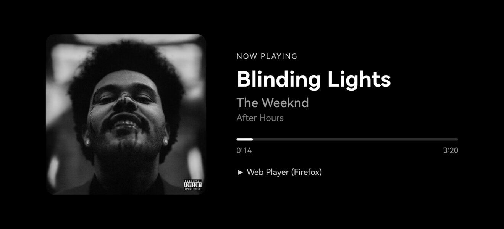
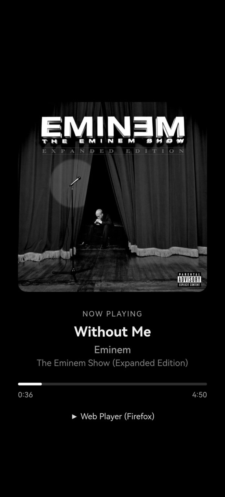
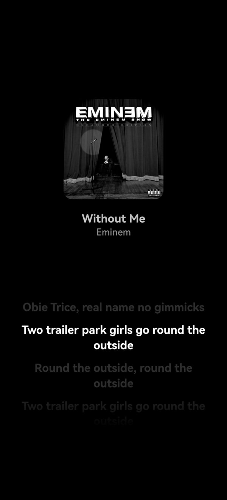

# Now-Playing

A tiny web app that shows what's currently playing on your Spotify account — album art, title, artist, album, a live progress bar and the playing device. Built to run as an always-on display on an old Android phone, served locally from the phone itself with Termux. You can also host it on HTTPS and run it without Termux (see [3c](#3c-run-on-a-phone-without-termux)).

No build step, no dependencies: plain HTML, CSS and JavaScript.


| Black | Album blur | Greyscale |
|---|---|---|
|  |  |  |

<sub>The Black view is a screenshot from the phone. The Album blur and Greyscale previews were generated from it to match each mode's styling.</sub>

### On the phone

| Landscape | Landscape · synced lyrics |
|---|---|
|  |  |

| Portrait | Portrait · synced lyrics |
|---|---|
|  |  |

## Features

- Current track or podcast episode, polled every 3 s, with a smoothly interpolated progress bar
- Three background modes, cycled with a **double tap**:
  - **Black** — pure black, ideal for OLED screens
  - **Album blur** — blurred album art behind everything
  - **Greyscale** — black background, greyscale art and accents
- **Synced lyrics** — **long press** to toggle a lyrics view with the current line highlighted and auto-scrolled (from [LRCLIB](https://lrclib.net); falls back to plain lyrics, and marks instrumentals)
- **Single tap** toggles fullscreen
- Portrait and landscape layouts
- Keeps the screen awake while visible (Screen Wake Lock API, where supported)
- Backs off polling while hidden and honours Spotify rate limits

## How it works

The app signs in with Spotify's **Authorization Code flow with PKCE**, entirely in the browser — no backend and no client secret. Tokens are stored in the browser's `localStorage` and refreshed automatically. Playback comes from [`GET /v1/me/player`](https://developer.spotify.com/documentation/web-api/reference/get-information-about-the-users-current-playback).

Spotify's API doesn't provide lyrics, so they come from [LRCLIB](https://lrclib.net), a free, open lyrics database (no key needed). Lyrics are matched by title, artist, album and duration, and synced to the locally interpolated playback position. Coverage depends on LRCLIB.

## Setup

### 1. Create a Spotify app

1. Go to the [Spotify Developer Dashboard](https://developer.spotify.com/dashboard) and **Create app**.
2. Add the redirect URI **`http://127.0.0.1:8080/`** (exactly, including the trailing slash).
3. Tick **Web API** and save.
4. Copy the **Client ID**. The client secret is not needed.

> Spotify requires the owner of a development-mode app to have a Premium account.

### 2. Set the Client ID

Edit `DEFAULT_CLIENT_ID` near the top of `app.js`, or leave it empty and paste your Client ID into the setup screen on first launch. A Client ID is not a secret, but use your own rather than the one in this repo.

### 3a. Run on a computer

```sh
python3 -m http.server 8080 --bind 127.0.0.1
```

Open <http://127.0.0.1:8080/> and click **Connect Spotify**.

### 3b. Run on an Android phone (Termux)

1. Install [Termux](https://github.com/termux/termux-app/releases) (and optionally [Termux:Boot](https://github.com/termux/termux-boot/releases) — both from the same source, GitHub or F-Droid, since their signatures must match).
2. Copy the app to the phone:
   ```sh
   adb shell mkdir -p /sdcard/spotify-monitor
   adb push index.html style.css app.js manifest.json icon.svg /sdcard/spotify-monitor/
   adb push termux/setup.sh termux/boot-setup.sh /sdcard/
   ```
3. Give Termux storage access (`termux-setup-storage`, or `adb shell pm grant com.termux android.permission.READ_EXTERNAL_STORAGE`).
4. In Termux, run:
   ```sh
   bash /sdcard/setup.sh
   ```
   This installs Python, creates `~/start-spotify-monitor.sh`, and starts the server on `127.0.0.1:8080` — reachable only from the phone itself. It also adds a line to `~/.bashrc` so the server starts whenever Termux is opened.
5. Open <http://127.0.0.1:8080/> in the phone's browser and connect Spotify.

#### Start on boot (optional)

With Termux:Boot installed and opened once, run in Termux:

```sh
bash /sdcard/boot-setup.sh
```

This installs `~/.termux/boot/start-spotify-monitor`, which starts the server when the phone boots.

On Huawei/EMUI and other aggressive battery managers, also allow Termux and Termux:Boot to auto-launch and run in the background (**Settings → Battery → App launch → Manage manually**), or the boot script won't run.

### 3c. Run on a phone without Termux

You don't need Termux if the app is served from somewhere else. Spotify only accepts `http://` redirect URIs on a loopback address (`127.0.0.1`). Any other address has to use `https://`. So opening `http://192.168.x.x:8080/` from another device on your Wi-Fi **will not work**. Use one of these options instead.

#### Option A: Host it on HTTPS (GitHub Pages)

This works on any phone or browser and needs no computer once it's set up.

1. Fork this repo, or push it to your own GitHub account.
2. In the repo, go to **Settings → Pages**. Under **Source**, pick **Deploy from a branch**, then choose `main` and `/ (root)`, and save.
3. After a minute the app is live at `https://<your-username>.github.io/<repo-name>/`.
4. Add that exact URL, including the trailing slash, as a redirect URI in your Spotify app. The app's setup screen also shows the exact redirect URI to register.
5. Open the URL in the phone's browser and connect Spotify. You can also use **Add to Home screen** to open it full screen like an app.

Any other static HTTPS host works too, such as Netlify, Cloudflare Pages or Vercel. Register whatever URL it gives you as the redirect URI.

#### Option B: Serve from a computer over USB (`adb reverse`)

This keeps everything local, but the computer has to stay on and connected.

1. On the computer, in the project folder, start the server:
   ```sh
   python3 -m http.server 8080 --bind 127.0.0.1
   ```
2. Connect the phone with USB debugging enabled, then run:
   ```sh
   adb reverse tcp:8080 tcp:8080
   ```
   This forwards the phone's `127.0.0.1:8080` to the computer, so the redirect URI from step 1 (`http://127.0.0.1:8080/`) still works.
3. Open <http://127.0.0.1:8080/> in the phone's browser and connect Spotify.

You need to run `adb reverse` again each time the phone reconnects.

> Sign-in and settings are saved separately for each URL. If you switch between URLs (for example from `127.0.0.1` to GitHub Pages), connect Spotify again, and make sure each URL is registered as a redirect URI.

## Files

| File | Purpose |
|---|---|
| `index.html` | Page structure: setup, login and player views |
| `style.css` | Layout, background modes, portrait/landscape |
| `app.js` | PKCE auth, token refresh, polling, rendering, gestures |
| `manifest.json`, `icon.svg` | Web app manifest and icon |
| `termux/setup.sh` | One-time Termux setup and server start |
| `termux/boot-setup.sh` | Installs the Termux:Boot start script |
